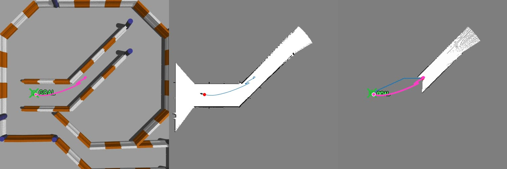
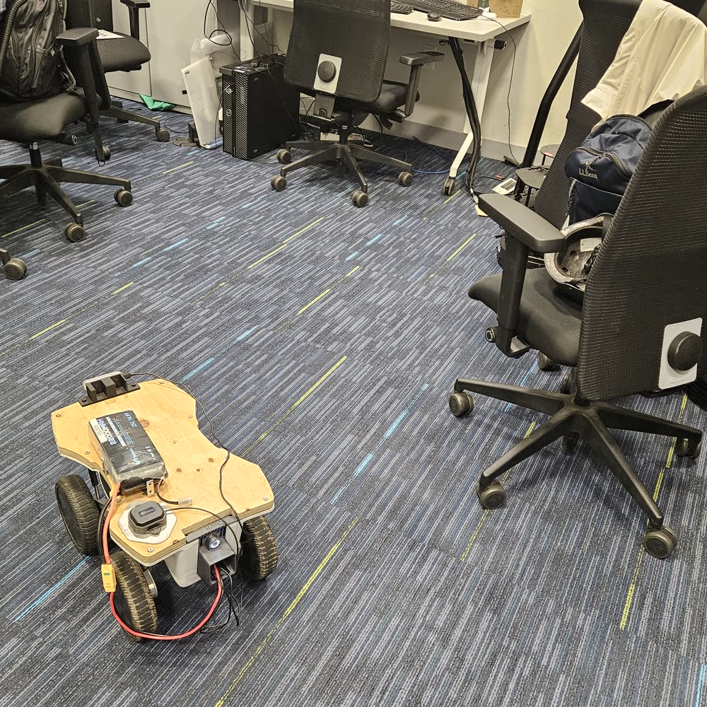

# robotics-summer-2026

This is the robotics work I did over the summer of 2026.

I started off by refreshing the basics of ROS 2 and object-oriented programming, then I worked on simulation with Clearpath Robotics' Jackal robot. After that, I moved on to real hardware, using a depth camera on the EarthSense TerraSentia robot to build maps of the lab and navigate to goals.

## Jackal simulation

The Jackal work runs entirely in Gazebo. The robot drives around a race track made of barriers, builds an occupancy map from its lidar, plans a route with A* and tries to reach goals placed around the track. Some of those goals are easy to reach, and one of them shows the limits of a simple navigator.

More in [`jackal_ws/`](jackal_ws).

## TerraSentia in the lab

The TerraSentia work runs on the real robot. An Intel RealSense depth camera is its only sensor. The depth images are used for a simple obstacle avoider, and to build an occupancy grid that a Dijkstra planner searches for routes to goals selected in RViz.

More in [`terrasentia_ws/`](terrasentia_ws).

## Repository layout

| Folder | What's in it |
| --- | --- |
| [`OOP/`](OOP) | Python object-oriented programming exercises |
| [`first_ros2_ws/`](first_ros2_ws) | ROS 2 workspace from learning the basics (publishers, subscribers and services) |
| [`jackal_ws/`](jackal_ws) | ROS 2 Foxy workspace for the Jackal simulation, along with its Dockerfile |
| [`terrasentia_ws/`](terrasentia_ws) | ROS 1 workspace that ran on the TerraSentia robot |
| [`videos/`](videos) | Demo videos of the Jackal simulation and the TerraSentia robot |