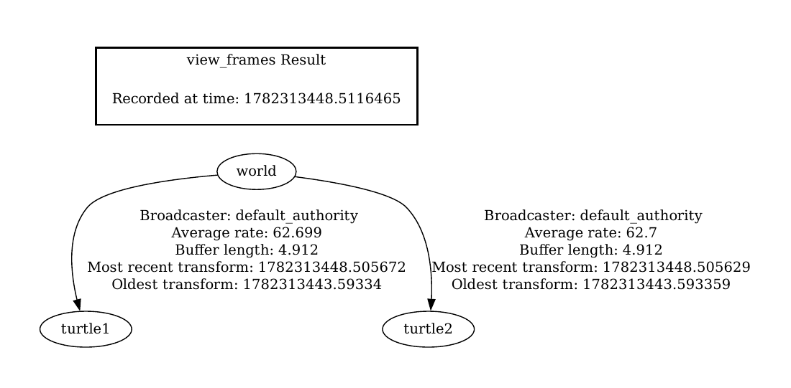

# first_ros2_ws

This ROS 2 workspace was used to learn publishers, subscribers, services and custom interfaces. These exercises come from the ROS tutorials https://wiki.ros.org/ROS/Tutorials and ROS2 documentation https://docs.ros.org/en/lyrical/Get-Started/Installation.html. 

This workspace uses ROS2 Lyrical.

## Packages

| Package | What it does |
| --- | --- |
| `first_demo` | A `talker` node that publishes `"Hello #N"` strings on `chatter`, along with a `listener` node that prints them |
| `calculator` | Defines the `Calc` service (`a`, `b`, `operation` → `result`) |
| `py_calculator` | A service server that adds, subtracts, multiplies or divides two numbers, and a client that calls it on `calc_service` |

## Building

```bash
cd first_ros2_ws
colcon build
source install/setup.bash
```

## Running

```bash
# publisher and subscriber
ros2 run first_demo publisher_node
ros2 run first_demo listener

# calculator service
ros2 run py_calculator server
ros2 run py_calculator client
```

## Docs

[`docs/`](docs) has a TF frame graph.

