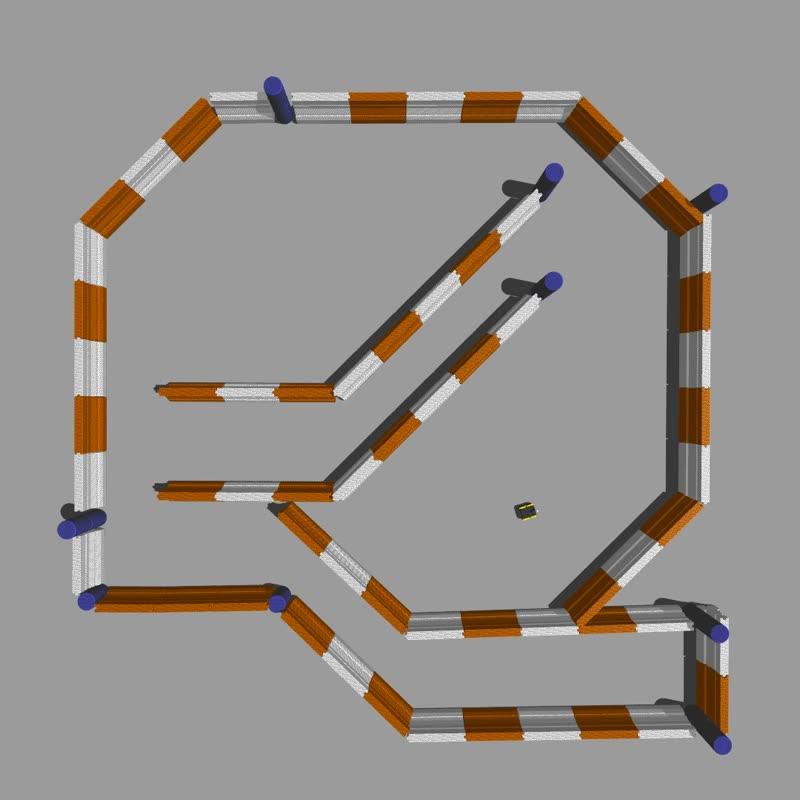
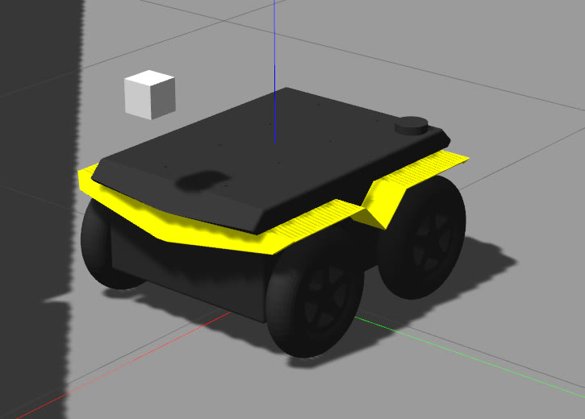
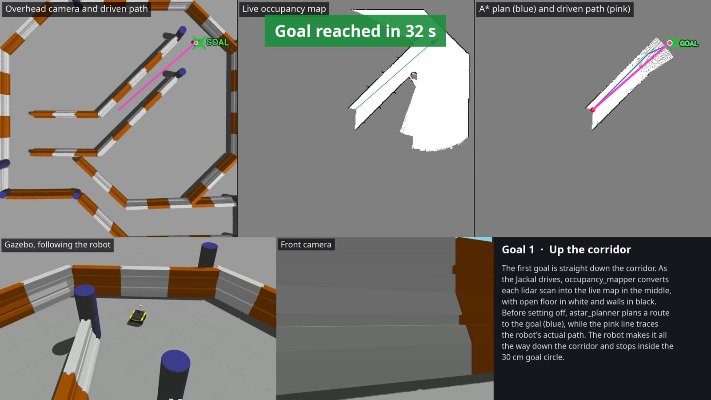

# jackal_ws

This ROS 2 Foxy workspace runs a simulated Clearpath Jackal in Gazebo, together with the autonomy packages I wrote for it. The Jackal is a four-wheeled ground robot, and in simulation it carries a 2D lidar on the front and a forward-facing camera.

All of the runs happen in the `jackal_race` world, a closed track built from orange and white barriers. The robot starts in a narrow corridor between two diagonal walls, which opens into a larger area inside the track.

<p>
  
  
</p>

The Clearpath dependencies and Jackal tutorials are available here: https://www.clearpathrobotics.com/assets/guides/kinetic/jackal/simulation.html.

## Packages

| Package | What it does |
| --- | --- |
| [`jackal_autonomy`](src/jackal_autonomy) | A reactive obstacle avoider that steers with the lidar, and a simple camera threshold for "lane detection" |
| [`occupancy_grid_mapping`](src/occupancy_grid_mapping) | Builds an occupancy grid from the lidar, plans a route with A* and drives the robot toward a goal |
| [`sensor_publisher`](src/sensor_publisher) | Subscribes to the robot's main sensors and logs what it receives, which is useful for checking the simulation is running |

The Clearpath packages (`jackal`, `jackal_simulator`, `jackal_desktop`, `jackal_robot`, `wireless` and `micro_ros_setup`) are not tracked in this repo. They are listed in [`dependencies.repos`](dependencies.repos) and can be fetched into `src/` with:

```bash
vcs import src < dependencies.repos
```

Two local changes were made to those Clearpath packages for this project (which are not in this repo yet). The first adds the front camera (`jackal_description/urdf/accessories/camera.urdf.xacro`), and the second adds a Gazebo plugin that publishes the robot's true position on `/ground_truth/state`, which the mapping packages rely on as a stand-in for GPS data outdoors.

## Setting up with Docker

Everything runs inside a Docker container built from the [`Dockerfile`](Dockerfile) in this folder. The container mounts this workspace at `/jackal_ws`, so changes made on the host show up inside it straight away. The full set of commands is in [`docker_commands.sh`](docker_commands.sh).

```bash
# build the image
docker build -t jackal_ros_foxy .

# allow GUI windows (Gazebo, RViz, plots) from the container
xhost +local:docker

# create the container
docker run -it --name jackal_container --network host --privileged --gpus all \
    -e NVIDIA_DRIVER_CAPABILITIES=all -e __NV_PRIME_RENDER_OFFLOAD=1 -e __GLX_VENDOR_LIBRARY_NAME=nvidia \
    -e DISPLAY=$DISPLAY -e QT_X11_NO_MITSHM=1 -v /tmp/.X11-unix:/tmp/.X11-unix:rw \
    -v ~/AllCode/GitHub/robotics-summer-2026/jackal_ws:/jackal_ws \
    jackal_ros_foxy

# reopen it in later sessions
docker start -ai jackal_container
docker exec -it jackal_container bash
```

The mapping packages draw their plots with matplotlib, which is not included in the Dockerfile. Inside the container, it can be installed with:

```bash
apt-get update && apt-get install -y python3-matplotlib python3-tk
```

## Running the simulation

```bash
source /opt/ros/foxy/setup.bash
source /jackal_ws/install/setup.bash

export JACKAL_LASER=1
ros2 launch jackal_gazebo jackal_world.launch.py
```

With Gazebo running, each node is started in its own terminal:

```bash
ros2 run jackal_autonomy obstacle_avoidance
ros2 run jackal_autonomy lane_detection

ros2 run occupancy_grid_mapping occupancy_mapper
ros2 run occupancy_grid_mapping astar_planner
ros2 run occupancy_grid_mapping navigator

ros2 run teleop_twist_keyboard teleop_twist_keyboard
```

Further commands, including the camera viewer, are in [`ros2_commands.sh`](ros2_commands.sh).

## What the demo shows

The demo video (`media/videos/jackal_gazebo_demo.mp4`) covers two experiments. In the first, the obstacle avoider drives around the open part of the track while lane detection runs on the front camera. In the second, the mapper, the A* planner and the navigator run together on three goals of increasing difficulty. The first two goals are reached, while the third sits behind a wall that the navigator cannot find its way around.

