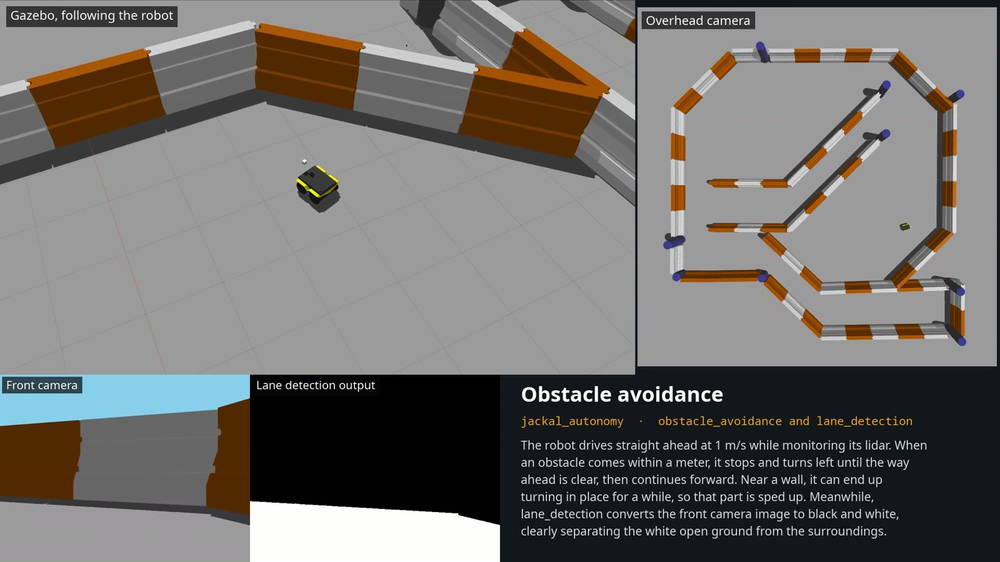
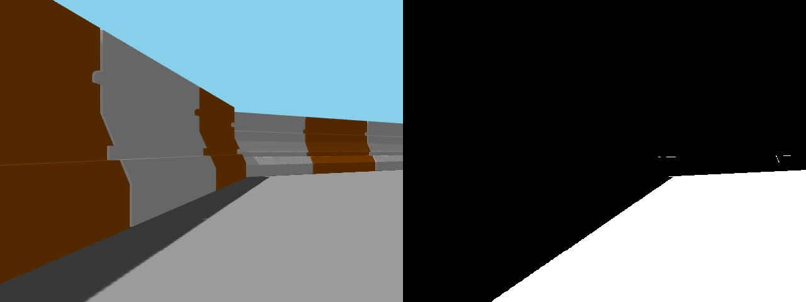

# jackal_autonomy

This package holds two simple autonomy nodes for the simulated Jackal. These packages use the Jackal's lidar readings for obstacle avoidance. This was a good first step before moving onto navigation. 



## obstacle_avoidance

The robot drives straight ahead at 1 m/s while monitoring its lidar. When any lidar return comes within a meter, it stops and turns left in place until the way ahead is clear (no objects detected), then continues forward.

This works well in open space, but close to a wall, the robot can end up turning in place for a long time. The lidar has 270 degree field of view around the robot, so a nearby wall stays in view for most of the turn, and the robot only drives off again once the wall falls into the small blind spot behind it. In the narrow corridor where the robot starts, both walls are always within a meter, so the Jackal never stops turning.

| | Topic | Type |
| --- | --- | --- |
| Subscribes | `/front/scan` | `sensor_msgs/LaserScan` |
| Publishes | `/cmd_vel` | `geometry_msgs/Twist` |

```bash
ros2 run jackal_autonomy obstacle_avoidance
```

## lane_detection

This node converts the front camera image to black and white. Any pixel brighter than 150 on a 0 to 255 scale becomes white, and the top half of the image is blanked out so that only the ground ahead is considered. The result is shown in an OpenCV window and published as a new image topic.

In the race world, the floor is the brightest object in view, so the output clearly separates the open ground from the barriers around it.



| | Topic | Type |
| --- | --- | --- |
| Subscribes | `/front_camera/image_raw` | `sensor_msgs/Image` |
| Publishes | `/lane_detection/processed_image` | `sensor_msgs/Image` (mono8) |

```bash
ros2 run jackal_autonomy lane_detection
```
