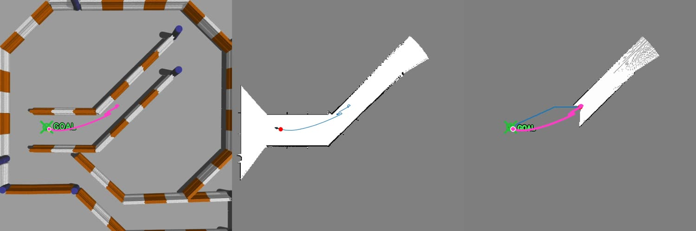

# occupancy_grid_mapping

This package builds a map of the race track from the Jackal's lidar, plans a route through it with A*, and drives the robot toward a goal. The three nodes are meant to run together since the mapper produces the map, while the planner and the navigator both read it.



All three nodes use the robot's ground truth position from Gazebo (`/ground_truth/state`) rather than its wheel odometry. Relying on odometry proved unreliable; for example, the robot's position would be incorrrect if it collided with a wall. The plots are drawn with matplotlib, which requires `python3-matplotlib` and `python3-tk` in the container.

## occupancy_mapper

The mapper keeps a 20 by 20 meter grid with 5 cm cells, centered on where the robot started. For every lidar scan, it traces each beam from the robot to the point it hit. The cells along the beam are marked as more likely to be free, and the cell at the end is marked as more likely to be occupied. These "log-odds" updates add up over many scans, so a single noisy reading does not change the map much.

The map is published for the other nodes and drawn live in a matplotlib window, with free space in white, walls in black and the robot's trail on top. Clicking on the plot publishes that point as a goal.

| | Topic | Type |
| --- | --- | --- |
| Subscribes | `/front/scan` | `sensor_msgs/LaserScan` |
| Subscribes | `/ground_truth/state` | `nav_msgs/Odometry` |
| Publishes | `/occupancy_grid` | `nav_msgs/OccupancyGrid` |
| Publishes | `/goal_pose` | `geometry_msgs/PoseStamped` |

## astar_planner

The planner waits for the first map, then searches it with A* for the shortest route from the robot to the goal, avoiding occupied cells. Cells that have not been seen yet are treated as free. It plans once, at startup, and draws the map with the planned route in its own window.

| | Topic | Type |
| --- | --- | --- |
| Subscribes | `/ground_truth/state` | `nav_msgs/Odometry` |
| Subscribes | `/occupancy_grid` | `nav_msgs/OccupancyGrid` |

## navigator

The navigator heads straight toward the goal. If the robot is facing more than 15 degrees away from it, it turns in place first, and otherwise it drives forward while steering toward the goal. Whenever the map shows an obstacle between 0.35 and 1.2 meters directly ahead, it makes a 60 degree turn away before carrying on. It stops once the robot is within 30 cm of the goal.

Because it only ever aims straight at the goal, the navigator cannot find its way around a wall that lies between the robot and the goal. This is shown in the demo, where goals 1 and 2 are reached, whereas with goal 3, the robot keeps running into the same wall.

| | Topic | Type |
| --- | --- | --- |
| Subscribes | `/ground_truth/state` | `nav_msgs/Odometry` |
| Subscribes | `/occupancy_grid` | `nav_msgs/OccupancyGrid` |
| Publishes | `/cmd_vel` | `geometry_msgs/Twist` |

## Running

```bash
ros2 run occupancy_grid_mapping occupancy_mapper
ros2 run occupancy_grid_mapping astar_planner
ros2 run occupancy_grid_mapping navigator
```

The goal is currently hard-coded to (5, 3) in both `navigator.py` and `astar_planner.py`. In the race world that point sits on the end of a wall, so it cannot be reached. The demo video used the points (6.8, 6.4), (−6, −1) and (7.5, 1).
