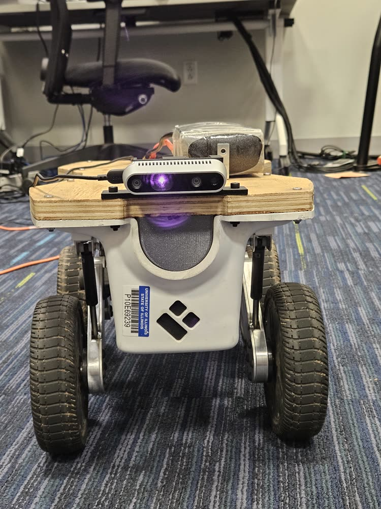
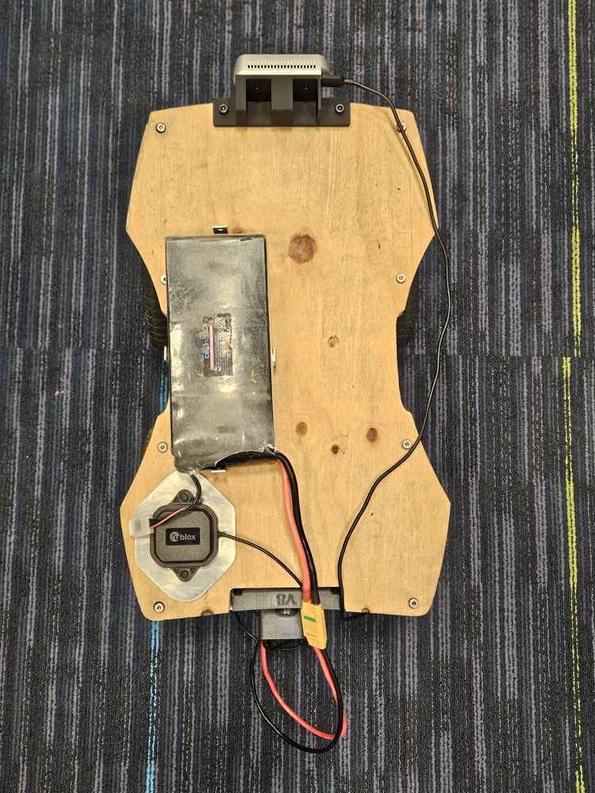
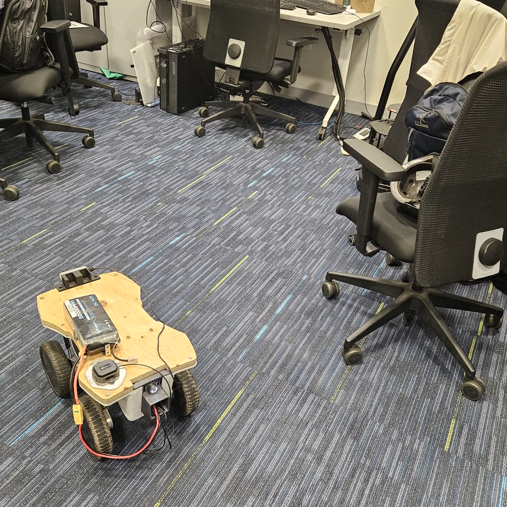
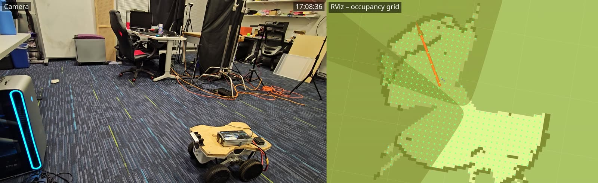

# terrasentia_ws

This ROS 1 workspace holds the packages that ran on the EarthSense TerraSentia robot in the lab. TerraSentia is an agricultural robot, designed to drive between rows of crops, and for these experiments it was fitted with an Intel RealSense depth camera on the front. That camera is the only sensor the programs here use.

<p>
  
  
  
</p>

The robot runs ROS 1 on an onboard computer. The programs are started over SSH on that computer, and RViz on a laptop shows the robot's state and the map over the lab network. The camera feed is not streamed to the laptop, which avoids the latency and bandwidth of sending video over the network. A plywood deck on top of the base carries a battery holder and a GPS module.

## Packages

| Package | What it does |
| --- | --- |
| [`depth_roomba`](src/depth_roomba) | Drives forward and turns away when the depth camera sees something within a meter |
| [`terrasentia_occupancy_mapper`](src/terrasentia_occupancy_mapper) | Builds an occupancy grid from the depth camera, plans routes with Dijkstra's algorithm and follows them |

Both packages are plain Python scripts in catkin packages, built in a catkin workspace on the robot.

## Running

The robot's own drivers are started first, and the autonomy mode is switched on. These commands are also in [`terrasentia_commands.sh`](terrasentia_commands.sh).

```bash
roslaunch terrahca terrahca_core.launch
rostopic pub /robot/autonomy std_msgs/Bool "data: true"
```

The simplest experiment is the depth-camera obstacle avoider:

```bash
rosrun depth_roomba depth_roomba.py
```

For mapping and path planning, the mapper, the planner and the controller run together, and goals are set in RViz with the 2D Nav Goal tool:

```bash
rosrun terrasentia_occupancy_mapper terrasentia_occupancy_mapper.py
rosrun terrasentia_occupancy_mapper dijkstra_planner.py
rosrun terrasentia_occupancy_mapper dijkstra_controller.py
```

It was often useful to drive the robot by hand, or to look at what the color camera sees:

```bash
rosrun teleop_twist_keyboard teleop_twist_keyboard.py cmd_vel:=/robot/cmd_vel
rosrun image_view image_view image:=/camera/color/image_raw _image_transport:=compressed
```

## What the demo shows

The demo video (`media/videos/terrasentia_demo.mp4`) starts with an early test of the obstacle avoider, then shows several runs of the mapping and planning programs. Each run is a phone recording of the robot placed side by side with the RViz screen at the same moment, so the robot's movement on camera is synced with the map.


