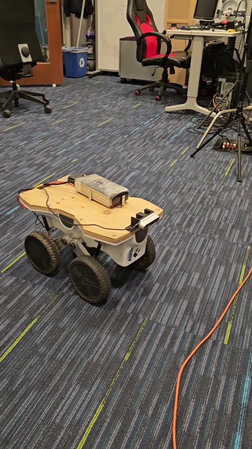
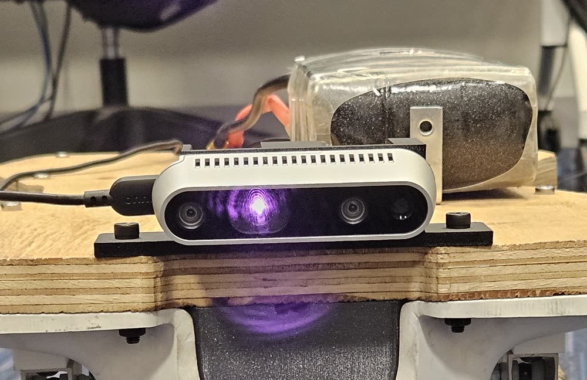

# depth_roomba

`depth_roomba` is the robot's simplest autonomous navigation program. It looks at the latest depth image and decides whether to keep going or turn. This follows from a similar package the simulated Jackal uses for obstacle avoidance, based off of lidar readings.

<p>
  
  
</p>

For each depth image, the node takes the central region (the middle third of the image, both across and down) and averages the distances in it. If that average is less than one meter, the robot stops and turns in place to avoid whatever is in front of it. Otherwise, it keeps driving forward at 0.25 m/s.

| | Topic | Type |
| --- | --- | --- |
| Subscribes | `/camera/depth/image_rect_raw` | `sensor_msgs/Image` |
| Publishes | `/robot/cmd_vel` | `geometry_msgs/Twist` |

```bash
rosrun depth_roomba depth_roomba.py
```

Because the node only looks at an average over the middle of the image, a thin obstacle such as a chair leg can be missed if most of that region sees the floor or a wall farther away.
