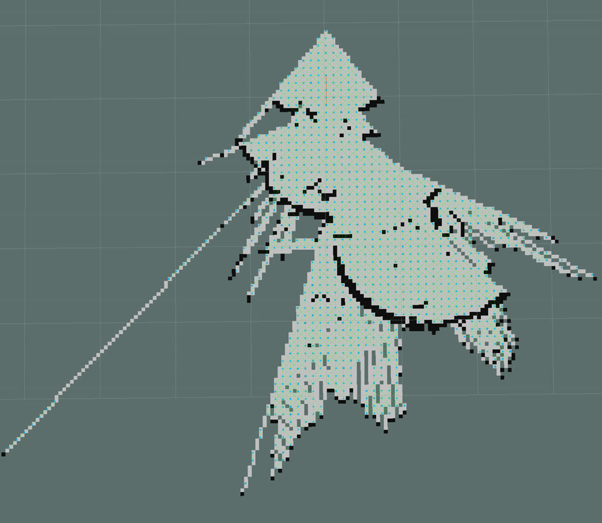

# terrasentia_occupancy_mapper

This package lets the TerraSentia build a map of the lab from its depth camera, plan a route to a goal and follow it. This TerraSentia's occupancy mapping follows from the work I did with the Jackal in simulation. The goal is picked by selecting a point on the map in RViz.



## How the nodes fit together

```
RealSense depth image
        │
        ▼
terrasentia_occupancy_mapper ──► /occupancy_grid ──► grid_to_graph (for display in RViz)
                                        │
                                        ▼
   2D Nav Goal in RViz ──────────► dijkstra_planner ──► /calculated_path
                                                              │
                                                              ▼
                                                     dijkstra_controller ──► /robot/cmd_vel
```

The mapper turns depth images into an occupancy grid. When a goal is clicked in RViz, the planner searches that grid for the shortest route and publishes it as a path. The controller then drives the robot along the path. Each new goal replaces the previous one, so the robot can be sent from one spot to the next without restarting anything.

All of the nodes are Python scripts in `scripts/` and are started with `rosrun`:

```bash
rosrun terrasentia_occupancy_mapper terrasentia_occupancy_mapper.py
rosrun terrasentia_occupancy_mapper grid_to_graph.py
rosrun terrasentia_occupancy_mapper dijkstra_planner.py
rosrun terrasentia_occupancy_mapper dijkstra_controller.py
```

## terrasentia_occupancy_mapper.py

The mapper projects each depth image onto the floor and updates a 20 by 20 meter grid with 5 cm cells. It uses the camera's calibration to work out where each depth reading lands, and the robot's odometry to place it in the map. The space between the camera and each reading is marked as more likely to be free, and the reading itself as more likely to be occupied, so the map solidifies as the robot sees the same area again. Depth readings beyond 8 meters are ignored, and the map is updated up to ten times a second.

| | Topic | Type |
| --- | --- | --- |
| Subscribes | `/camera/depth/image_rect_raw` | `sensor_msgs/Image` |
| Subscribes | `/camera/depth/camera_info` | `sensor_msgs/CameraInfo` |
| Subscribes | `/robot/odometry/local/raw` | `nav_msgs/Odometry` |
| Publishes | `/occupancy_grid` | `nav_msgs/OccupancyGrid` |
| Publishes | `/goal_pose` | `geometry_msgs/PoseStamped` |
| Publishes | `/robot_pose_marker` | `visualization_msgs/Marker` |

## grid_to_graph.py

This node connects neighboring free cells of the grid into a graph and draws it in RViz as the cyan dots seen on the map. This is included to make the planner's view of the world visible. It does not take part in any planning itself.

| | Topic | Type |
| --- | --- | --- |
| Subscribes | `/occupancy_grid` | `nav_msgs/OccupancyGrid` |
| Publishes | `/graph_visualization` | `visualization_msgs/MarkerArray` |

## dijkstra_planner.py

When a goal arrives from RViz, the planner runs Dijkstra's algorithm on the occupancy grid to find the shortest route from the robot's current position to the goal. It treats the grid as a graph, with each traversable cell connected to its neighbors. Starting at the robot's position, Dijkstra's algorithm explores outward, keeping track of the lowest-cost route to each cell until it reaches the goal. Obstacles are first expanded by one cell to maintain a safety margin, and the grid is searched at half resolution (10 cm per cell) to keep planning fast. The resulting route is published as a path, which RViz displays.

| | Topic | Type |
| --- | --- | --- |
| Subscribes | `/occupancy_grid` | `nav_msgs/OccupancyGrid` |
| Subscribes | `/robot/odometry/local/raw` | `nav_msgs/Odometry` |
| Subscribes | `/move_base_simple/goal` | `geometry_msgs/PoseStamped` |
| Publishes | `/calculated_path` | `nav_msgs/Path` |

## dijkstra_controller.py

The controller follows the path by steering toward a point 40 cm ahead along it. Its turning speed is proportional to how far the robot is facing away from that point, and its forward speed (up to 0.25 m/s) drops as that heading error grows. When the path starts off to the side, the robot therefore turns almost in place first and speeds up as it lines up. It stops once the robot is within 20 cm of the goal.

| | Topic | Type |
| --- | --- | --- |
| Subscribes | `/robot/odometry/local/raw` | `nav_msgs/Odometry` |
| Subscribes | `/calculated_path` | `nav_msgs/Path` |
| Publishes | `/robot/cmd_vel` | `geometry_msgs/Twist` |

## occupancy_obstacle_avoider.py

This is a map-based version of the depth "roomba." It drives forward at 0.2 m/s and turns when the occupancy grid shows something within 0.6 meters ahead of the robot. Because it reads the map instead of a single depth image, it can react to obstacles the camera saw a moment ago, even if they are no longer in view.

| | Topic | Type |
| --- | --- | --- |
| Subscribes | `/occupancy_grid` | `nav_msgs/OccupancyGrid` |
| Subscribes | `/robot/odometry/local/raw` | `nav_msgs/Odometry` |
| Publishes | `/robot/cmd_vel` | `geometry_msgs/Twist` |

```bash
rosrun terrasentia_occupancy_mapper occupancy_obstacle_avoider.py
```
